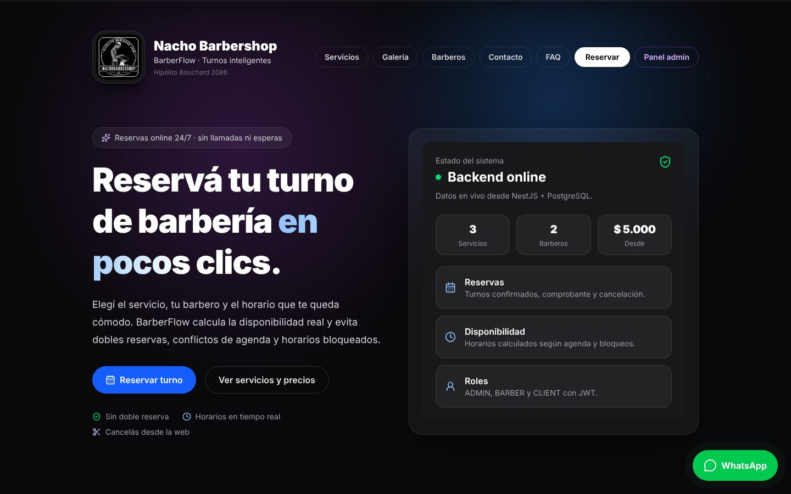
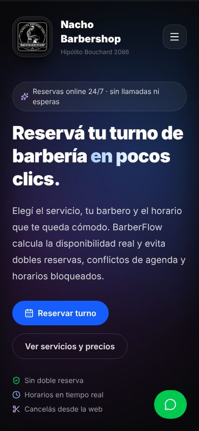

# BarberFlow Web · Nacho Barbershop

Frontend de **BarberFlow**, un sistema de turnos online para barbería, hecho para un negocio real: **Nacho Barbershop** (Hipólito Bouchard 2086).

Los clientes consultan servicios y precios, eligen barbero, ven horarios disponibles en tiempo real, reservan, reciben un comprobante y pueden cancelar desde la web. El dueño administra todo desde un panel interno.

**[Ver demo online](https://barberflow-web-six.vercel.app/)** · [Documentación de la API (Swagger)](https://barberflow-api-9feo.onrender.com/api/docs) · [Repositorio del backend](https://github.com/IgnacioGodoy2002/barberflow-api)

> El backend está en el plan gratuito de Render y se duerme cuando nadie lo usa. La primera carga puede tardar hasta un minuto. La web lo detecta y muestra el aviso "Despertando el servidor…".



| Galería con visor de fotos | Versión mobile |
| --- | --- |
|  |  |

## Funcionalidades

### Para el cliente
- Servicios con duración, precio y margen entre turnos, traídos desde la API.
- Barberos con los servicios que hace cada uno.
- Disponibilidad calculada por servicio, barbero y fecha (sin doble reserva y respetando bloqueos de agenda).
- Registro e inicio de sesión con JWT.
- Reserva online con comprobante que se puede copiar o mandar por WhatsApp.
- "Mis turnos": consulta, filtros y cancelación con confirmación.
- Galería de trabajos reales con visor ampliado (teclado: ← →, Esc).
- Contacto: mapa, horarios y consulta rápida que abre WhatsApp con el mensaje armado.
- Preguntas frecuentes en acordeón.

### Panel interno (`/admin`)
- Dashboard con métricas de la semana.
- Calendario de turnos, cambio de estado (confirmado, completado, ausente, cancelado) y comprobantes.
- Turnos manuales para clientes que reservan por teléfono o WhatsApp.
- Alta y edición de servicios, barberos y asignación de servicios por barbero.
- Horarios de trabajo y bloqueos de agenda (vacaciones, descansos, etc.).
- Listado de clientes.

### Experiencia y detalles técnicos
- Animaciones: cursor personalizado con efecto magnético en botones, aparición escalonada de secciones al hacer scroll, entrada animada del hero, fondo que sigue al mouse, barra de progreso de lectura y contadores animados.
- Todas las animaciones se desactivan si el sistema tiene activado "reducir movimiento", y el cursor solo aparece con mouse (nunca en táctil).
- Estado del backend en vivo (conectando, despertando, online o sin conexión, con botón para reintentar) y esqueletos de carga.
- SEO: metadatos, vista previa al compartir (Open Graph), datos estructurados de negocio local (schema.org `HairSalon`), `sitemap.xml` y `robots.txt`.
- Accesibilidad: enlace "Saltar al contenido", formularios con etiquetas, foco visible y navegación por teclado.
- Imágenes optimizadas en WebP con carga diferida.

## Tecnologías

**Frontend:** React 19 · TypeScript · Vite · Tailwind CSS 4 · Lucide · Vercel

**Backend ([barberflow-api](https://github.com/IgnacioGodoy2002/barberflow-api)):** NestJS · PostgreSQL (Neon) · Prisma · JWT con roles (ADMIN, BARBER, CLIENT) · Swagger · Render

## Estructura

```text
src/
├── components/
│   ├── motion/            # Cursor, aparición al hacer scroll, progreso, gradiente, contadores
│   ├── SiteHeader.tsx     # Encabezado + barra compacta fija
│   ├── HeroSection.tsx    # Hero con estado del backend en vivo
│   ├── ServicesSection.tsx, BarbersSection.tsx, GallerySection.tsx, ...
│   ├── BookingForm.tsx    # Flujo de reserva
│   ├── MyAppointments.tsx # Turnos del cliente
│   └── Admin*.tsx         # Panel interno
├── config/
│   ├── api.ts             # URL de la API
│   └── business.ts        # Datos de la barbería (dirección, WhatsApp, horarios)
├── data/testimonials.ts   # Opiniones reales de clientes
├── pages/AdminPage.tsx
├── types.ts
└── App.tsx
```

Los datos del negocio (teléfono, dirección, horarios) están centralizados en `src/config/business.ts`.

## Correr el proyecto

```bash
cp .env.example .env   # VITE_API_URL=https://barberflow-api-9feo.onrender.com
npm install
npm run dev
```

En Windows PowerShell, si aparece un error de ejecución de scripts, usá `npm.cmd install` y `npm.cmd run dev`.

Build de producción:

```bash
npm run build
```

## Autor

**Ignacio Gabriel Godoy**, desarrollador Backend / Fullstack Jr.

Proyecto personal que une mi experiencia real atendiendo en la barbería con el desarrollo fullstack.

[Portfolio](https://portfolio-ignacio-pi.vercel.app/) · [GitHub](https://github.com/IgnacioGodoy2002)
